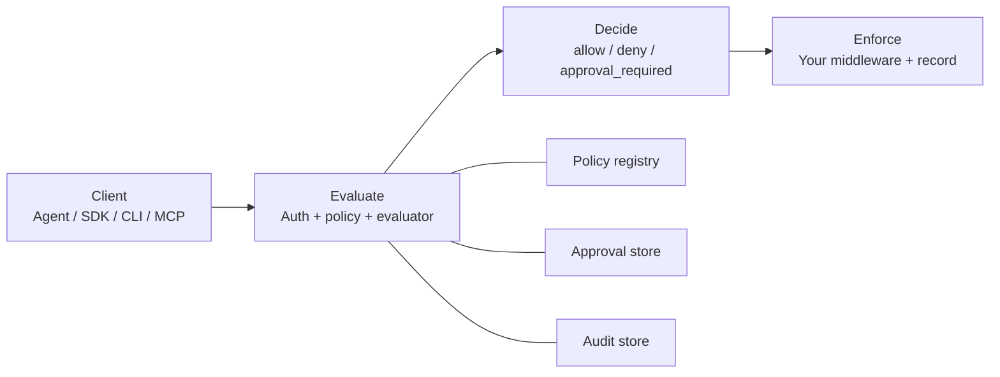

# `@limetry/server`

Self-run Limetry evaluation server: policy checks, optional approvals, and
privacy-safe audit storage over HTTP.

Published docs (rendered):
[Architecture and data dictionary](https://limetry.org/docs/server/architecture)

Source docs (this repo):
[`packages/web/content/docs/server/architecture.mdx`](../web/content/docs/server/architecture.mdx)

## Architecture



Rendered docs: [Architecture and data dictionary](https://limetry.org/docs/server/architecture).

| Path | Role |
| --- | --- |
| `POST /v1/policy/evaluate` | Match an `ActionIntent` against an `ActionPolicy` |
| `POST /v1/actions/record` | Record `executed` / `skipped` / `blocked` |
| `GET /v1/audit` | List privacy-safe audit events |
| `PUT /v1/policies/:id` | Upsert a policy document |
| Approvals API | Resolve `approval_required` rows bound to a payload hash |

Policy matching uses the **full** intent. Audit stores a **projected** intent
after secret scrubbing (`audit_mode=minimal` by default). See
[Minimize audit data](https://limetry.org/docs/server/data-minimization).

## Data dictionary (durable Postgres)

Migrated when `USE_POSTGRES_STORE=true`
(`src/services/postgres-store.ts`).

### `limetry_policies`

| Column | Type | Description | Sensitive |
| --- | --- | --- | --- |
| `tenant_id` | text | Tenant scope | no |
| `policy_id` | text | Policy document id | no |
| `policy_json` | jsonb | Full `ActionPolicy` | low |
| `created_at` | timestamptz | Insert time | no |
| `updated_at` | timestamptz | Last upsert | no |

### `limetry_audit_log`

| Column | Type | Description | Sensitive |
| --- | --- | --- | --- |
| `id` | bigserial | Event id | no |
| `tenant_id` | text | Tenant scope | no |
| `event_type` | text | e.g. `policy.evaluated` | no |
| `subject_id` | text | Decision / intent subject | no |
| `details` | jsonb | Privacy-safe projection | maybe |
| `created_at` | timestamptz | Event time | no |

### `limetry_governance_state`

| Column | Type | Description | Sensitive |
| --- | --- | --- | --- |
| `tenant_id` | text | Tenant scope | no |
| `agent_id` | text | Agent identity | no |
| `policy_id` | text | Policy id | no |
| `state_json` | jsonb | Per-agent state | low |
| `updated_at` | timestamptz | Last write | no |

Also created: `limetry_users`, `limetry_access_tokens`, `limetry_rules`
(operator auth and scoped tokens). Treat `password_hash` and raw token values
as secrets — never log them.

### Approvals

With the SQLite file store, pending approvals persist in `limetry_approvals`
(`decision_id`, `payload_hash`, intent snapshot, status, reviewer, timestamps).
With `USE_POSTGRES_STORE=true`, approvals default to the in-memory store for
that process — plan multi-instance durability accordingly.

## Audit field projection

| Intent field | `minimal` | `forensics` |
| --- | --- | --- |
| `intent_id`, `policy_id`, `agent_id`, `action_type`, `resource`, `cost`, `issued_at` | stored (resource scrubbed) | stored (resource scrubbed) |
| `metadata` | omitted | redacted |
| `nonce` | omitted | omitted |

`policy.evaluated` details include `approved`, `reasons`, `policy_id`,
projected intent fields, and `audit_mode`. `action.recorded` adds `outcome`
and optional `decision_id`; open `details` bags appear only in `forensics`.

## Logging

Prefer `tenant_id`, `agent_id`, `policy_id`, `intent_id`, `decision_id`,
`event_type` in process logs. Do not log passwords, API tokens, Authorization
headers, chat transcripts, or raw intent metadata.

## Local development

From the monorepo root (Yarn Berry):

```bash
yarn workspace @limetry/server dev
```

Environment template: repository root `.env.example`. Operator guide:
[Self-run the server](https://limetry.org/docs/server/self-hosting).

## License

MIT
